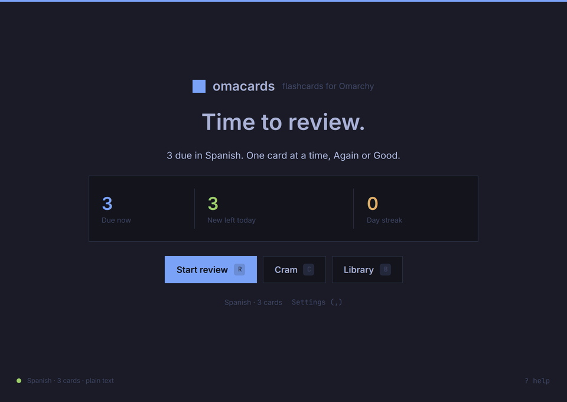

# omacards




A keyboard-first flashcards app for Omarchy. It has two study modes:

- **Review** — FSRS-5 long-term scheduling with Again and Good.
- **Cram** — endless in-session Leitner boxes (1, 2, 4, 8, 16 cards) that reset on Again and re-surface weak cards until you quit.

Deck content lives in plain text files under `~/.local/share/omacards/decks/`, so agents and editors can change it directly. Scheduling state lives in a SQLite sidecar at `~/.local/share/omacards/state.db`; deleting the database never deletes a card.

## Install

```sh
./bin/build     # build to build/omacards
./bin/test      # offscreen Qt Test suite
./bin/install   # makepkg -fsi, adds the binary, launcher entry and icon
```

Requirements: Qt 6 (base, declarative, wayland, SQL), qmake6, gcc/make. Optional: `unzip` for Anki `.apkg` imports, `tectonic`/`pdftocairo` or `latex`/`dvisvgm` for LaTeX math. Without a TeX toolchain, math is rendered as Unicode.

## Keyboard shortcuts

| Key | Action |
| --- | --- |
| `Space`, `↑`, `↓`, `Enter` | Flip the card / main action |
| `1`, `A`, `←` | Again |
| `2`, `G`, `→` | Good |
| `N` | New card |
| `D` | New deck |
| `B` | Browse and search cards |
| `S` | Stats for today and this session |
| `Ctrl+Z` / `Ctrl+Shift+Z` | Undo / redo a card or deck edit |
| `I` | Import a file |
| `E` | Open the current deck file in your editor |
| `C` | Cram mode |
| `R` | Review mode |
| `?`, `F1` | Shortcut overlay |
| `Q` | Quit |

Closing the window hides it to the system tray. The tray tooltip shows the number of due cards; clicking it opens a review session.

`B` opens the card browser. It searches questions, answers and tags, and each card can be edited or deleted there. Card and deck edits are undoable with `Ctrl+Z`; `Ctrl+Shift+Z` (or `Ctrl+Y`) redoes them. The same history covers cards added from the GUI, CLI imports and deck deletions. Review answers are intentionally not undoable, so a lapse cannot be erased by accident.

## Deck format

```text
# Deck: Spanish
# Description: Words and phrases
---
Q: What is "gato"?
A: cat
tags: vocab, animals
---
Q: Solve \(x^2+1=0\)
A: \(x=\pm i\)
---
Q: The {{c1::cat}} sleeps.
type: cloze
```

A card's id is a hash of its deck, question and answer, so editing a card resets its FSRS state but keeps the file readable. An explicit `id:` line pins the identity across edits.

## Agent CLI

Every command accepts `--json`, prints errors to stderr and exits 0 or 1.

```sh
omacards check --json
omacards decks --json
omacards cards --deck Spanish --json
omacards search gato --deck Spanish --json
omacards add-deck Spanish --json
omacards add-card --deck Spanish -q 'What is "gato"?' -a cat --tags vocab --json
omacards edit-card -c <card-id> -a 'a cat' --json
omacards delete-card -c <card-id> --json
omacards delete-deck Spanish --json
omacards import ~/Downloads/deck.apkg --deck Spanish --json
omacards import ~/Downloads/words.csv --deck Spanish --json
omacards due --deck Spanish --json
omacards review -c <card-id> -r 3 --json
omacards cram --deck Spanish --steps 20 --json
omacards stats --json
omacards skill install --json
```

`omacards skill install` writes a short agent skill to `~/.agents/skills/omacards/SKILL.md`. Set `OMACARDS_DECKS_DIR` and `OMACARDS_STATE_DB` to isolate data for tests or scripts.

## Why Leitner for cram?

Cram needs no persistent state, must never end, and should re-show weak cards quickly. A five-box Leitner queue gives exactly that: correct answers promote a card to a longer card-count interval, Again resets it to box 1, and the queue is refilled forever. FSRS remains the long-term scheduler where spaced intervals and retention targets matter.

## Layout

```text
src/backend.{h,cpp}      cards, files, SQLite, modes, imports
src/fsrs.{h,cpp}         FSRS-5 model (Again=1, Good=3)
src/deck.{h,cpp}         plain-text deck parser/writer
src/store.{h,cpp}        SQLite sidecar
src/mathrender.{h,cpp}   LaTeX to SVG with Unicode fallback
src/main.cpp             app setup, system tray, CLI dispatch
src/Main.qml             window, keyboard, layout
src/theme.* src/translator.*  live Omarchy theme and language
tests/                   Qt Test suite
pkgbuild/                Arch package, desktop entry, icon
```

Theme watching follows Omacut and Monologue (MIT, David Heinemeier Hansson).
