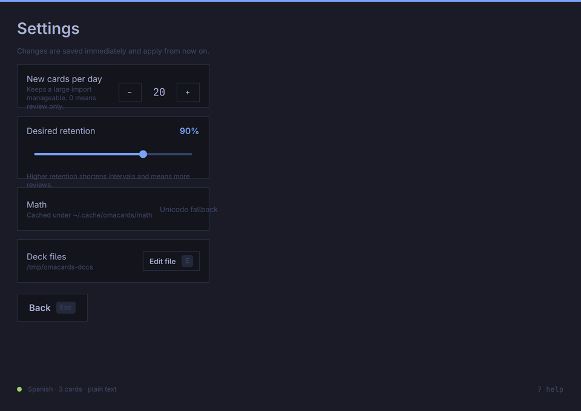

# omacards


A keyboard-first flashcards app for Omarchy. It follows Omarchy's theme and is built for agent-driven study.

It has two study modes:

- **Review** — FSRS-5 long-term scheduling with Again and Good.
- **Cram** — endless in-session Leitner boxes (1, 2, 4, 8, 16 cards) that reset on Again and re-surface weak cards until you quit.

Deck content lives in plain text files under `~/.local/share/omacards/decks/`, so agents and editors can change it directly. Scheduling state lives in a SQLite sidecar at `~/.local/share/omacards/state.db`; deleting the database never deletes a card.

## Install

```sh
./bin/build     # build to build/omacards
./bin/test      # offscreen Qt Test suite
./bin/install   # makepkg -fsi, adds the binary, launcher entry and icon
```

Enable the local pre-commit format check with `git config core.hooksPath .githooks`. It checks staged C++ files; CI checks the whole tree.

Requirements: Qt 6 (base, declarative, wayland, SQL), qmake6, gcc/make.
Optional: `unzip` for Anki `.apkg` imports, `tectonic`/`pdftocairo` or `latex`/`dvisvgm` for LaTeX math. (Without a TeX toolchain, math is rendered as Unicode.)

## LaTeX math

Math inside `\(...\)` or `$$...$$` becomes a cached SVG when a TeX toolchain is available.

### On Omarchy:

```sh
omarchy install package tectonic
omarchy install package poppler
```

### On Arch:

```sh
sudo pacman -S tectonic poppler
```

### After install:

```sh
mkdir -p /tmp/omacards-tex
printf '\\documentclass{article}\n\\begin{document}$x^2$\\end{document}\n' > /tmp/omacards-tex/warm.tex
tectonic --untrusted --outdir=/tmp/omacards-tex /tmp/omacards-tex/warm.tex
```

```
```
This is a one-time, global download of Tectonic's TeX bundle (stored in `~/.cache/tectonic`) — not something you repeat per deck. Doing it ahead of time avoids a long pause on the first card that uses math. After that, normal renders use Tectonic's `--only-cached` mode, and each expression is cached once as a neutral SVG under `~/.cache/omacards/math`. The active theme colors the SVG at display time, so switching themes needs no re-render. Restart omacards after installing so it detects the toolchain, and confirm with `omacards check --json` (`"math": "LaTeX (SVG)"`). Delete `~/.cache/omacards/math` to force a re-render.

## Keyboard shortcuts

| Key | Action |
| --- | --- |
| `Space`, `Enter`, `Return` | Start a review, Reveal the Flashcard, or continue |
| `↑`, `↓` | Scroll a long card, or Reveal the Flashcard when there is no more to scroll |
| `J` / `K` | Scroll a long card while studying; move the card selection in the library |
| `1`, `A`, `←` | Again |
| `2`, `G`, `→` | Good |
| `N` | New card |
| `D` | New deck |
| `B` | Browse and search cards |
| `Enter` | Edit the selected card in the library |
| `Delete` / `Backspace` | Delete the selected card in the library |
| `/` | Focus library search |
| `S` | Stats for this Study day and this Study session |
| `,` | Settings: New-card allowance, Day-start hour and Desired retention |
| `Ctrl+Z` / `Ctrl+Shift+Z` | Undo / redo a card or deck edit |
| `I` | Import a file |
| `E` | Open the current deck file in your editor |
| `C` | Cram mode |
| `R` | Review mode |
| `?`, `F1` | Shortcut overlay |
| `Q` | Quit |

Closing the window quits the app. While omacards is open, the tray tooltip shows the number of Due cards; clicking it opens a Review Study session.

`B` opens the card browser. It searches questions, answers and tags, and each card can be edited or deleted there. The selected row is highlighted; `J`/`K` (or the arrow keys) move it, `Enter` edits it and `Delete` removes it. Clicking a row selects it, and `/` jumps to the search field. Card and deck edits are undoable with `Ctrl+Z`; `Ctrl+Shift+Z` (or `Ctrl+Y`) redoes them. The same history covers GUI edits, GUI imports and deck deletions. CLI writes run in separate processes and are not part of the GUI undo history. Ratings are intentionally not undoable, so a lapse cannot be erased by accident.

## Settings

Press `,` (or the gear button) to open the Settings screen. Settings are stored in the SQLite sidecar and apply as soon as you change them.



- **New-card allowance** (default 20) caps how many New cards enter a Review Study session. This keeps a large Anki import manageable. Set it to 0 to study only cards that are already in review.
- **Day-start hour** (default 00:00) sets when a Study day rolls over. A card due at 22:00 is available from 22:00 on its due date with the default, but waits until 03:00 if you set the Day-start hour to 3 AM. The library, the due counts and the New-card allowance all use this boundary, so an Available card is always in the study queue. A 3 AM rollover helps if you often study just before midnight. The day does not reset until you have had a chance to finish.
- **Desired retention** (default 90%) is the probability of recall Review scheduling aims to maintain. Higher values shorten intervals and mean more reviews; lower values stretch intervals. The change affects future Ratings, not existing due dates.

Again repeats come back after a 60-second break in the same session. Set `OMACARDS_AGAIN_DELAY_MS` (milliseconds) to adjust that break; `0` shows the card immediately.

Due cards are shown before New cards, and New cards follow deck-file order. The tray count and due badge reflect the Available cards in the study queue after the New-card allowance. `omacards config` exposes the same Settings to agents.

## Deck format

```text
# Deck: Spanish
# Description: Words and phrases
---
Q: What is "gato"?
A: cat
tags: vocab, animals
---
Q: Solve \(x^2+1=0\)
A: \(x=\pm i\)
---
Q: The {{c1::cat}} sleeps.
type: cloze
```

Questions and answers may span multiple lines: indent every continuation line with exactly two spaces. `omacards check` reports lines with more indentation as Deck issues.

A card's id is a hash of its deck, question and answer, so editing a card resets its Scheduling state but keeps the file readable. An explicit `id:` line pins the identity across edits.

Anki `.apkg` imports preserve HTML entities, tags, and cloze note types (`{{c1::answer}}`; `::hint` is dropped). Referenced media is extracted next to the deck files under `media/<deck>/` and image sources are rewritten to local `file://` URLs, so images still render in the study view. CSV/TSV files with a `question,answer,tags` header are imported as basic cards.

## Agent CLI

Every command accepts `--json`, prints errors to stderr and exits 0 or 1.

```sh
omacards check
omacards check --deck Spanish
omacards decks
omacards cards --deck Spanish
omacards search gato --deck Spanish
omacards add-deck Spanish
omacards add-card --deck Spanish -q 'What is "gato"?' -a cat --tags vocab
omacards edit-card -c <card-id> -a 'a cat'
omacards delete-card -c <card-id>
omacards delete-deck Spanish
omacards import ~/Downloads/deck.apkg --deck Spanish
omacards import ~/Downloads/words.csv --deck Spanish
omacards due --deck Spanish
omacards review -c <card-id> -r 3
omacards cram --deck Spanish --steps 20
omacards stats
omacards config
omacards config --new-card-allowance 10 --day-start-hour 3 --retention 0.9
omacards skill install
```

`omacards skill install` writes a short agent skill to `~/.agents/skills/omacards/SKILL.md`. Set `OMACARDS_DECKS_DIR` and `OMACARDS_STATE_DB` to isolate data for tests or scripts.

Deck-writing commands (`add-deck`, `add-cards`, `add-card`, `import`, `edit-card` and `delete-card`) reload the file they just wrote and run the same deck checks as `check`. If a write would introduce an Error, the previous file is restored (or a newly created deck is removed), no history entry is recorded, and the command exits 1 with an Error that includes a fix hint. Warnings, such as duplicate questions or unsupported math macros, do not block a write, and decks that already contain Deck issues can still be edited.

## Why Leitner for cram?

Cram needs no persistent state, must never end, and should re-show weak cards quickly. A queue of five Leitner boxes gives exactly that: Good ratings promote a card to a longer card-count interval, Again resets it to Leitner box 1, and the queue is refilled forever. FSRS remains the long-term scheduler where spaced intervals and Desired retention matter.

## Layout

```text
src/backend.{h,cpp}      cards, files, SQLite, modes, study sessions
src/importer.{h,cpp}     CSV/TSV and Anki parsing into card drafts
src/domain.{h,cpp}       shared mode, rating and card-type values
src/filehistory.{h,cpp}  atomic undo/redo of whole deck files
src/fsrs.{h,cpp}         FSRS-5 model (Again=1, Good=3)
src/deck.{h,cpp}         plain-text deck parser/writer
src/store.{h,cpp}        SQLite sidecar
src/insessionprogression.{h,cpp}  Leitner boxes and Pending repeats
src/mathrender.{h,cpp}   LaTeX to SVG with Unicode fallback
src/main.cpp             app setup, system tray, CLI dispatch
src/Main.qml             window, keyboard, layout
src/theme.* src/translator.*  live Omarchy theme and language
tests/                   Qt Test suite
pkgbuild/                Arch package, desktop entry, icon
```

Theme watching follows Omacut and Monologue (MIT, David Heinemeier Hansson).

## Roadmap
- Omarchy plugin support
- Install script
- Tectonic warming script
- Fix tray entry
- Update README.md pictures
- Redo deck format in README.md
- Update layout in README.md
- Ensure switching themes works properly
- Investigate LaTeX rendered size discrepancy: `\sqrt{10}` in the local Taylor-Series-Worked-Problems (“Worked”) deck renders at a different size than the surrounding math. Check SVG root width/height scaling in `src/mathrender.cpp` (`scaleSvgRoot`, `svgPixelSize`) and the `` sizing emitted for rich text; reproduce with `omacards preview --deck Taylor-Series-Worked-Problems --format html` and add a regression check for the fix.
