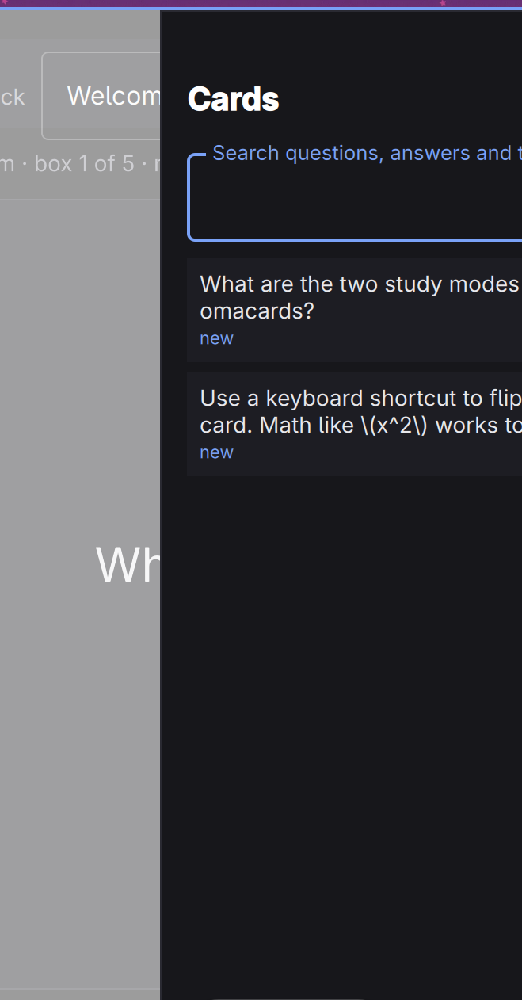

# omacards




A keyboard-first flashcards app for Omarchy. It follows Omarchy's theme and is built for agent-driven study.

It has two study modes:

- **Review** — FSRS-5 long-term scheduling with Again and Good.
- **Cram** — endless in-session Leitner boxes (1, 2, 4, 8, 16 cards) that reset on Again and re-surface weak cards until you quit.

Deck content lives in plain text files under `~/.local/share/omacards/decks/`, so agents and editors can change it directly. Scheduling state lives in a SQLite sidecar at `~/.local/share/omacards/state.db`; deleting the database never deletes a card.

## Install

```sh
./bin/build     # build to build/omacards
./bin/test      # offscreen Qt Test suite
./bin/install   # makepkg -fsi, adds the binary, launcher entry and icon
```

Enable the local pre-commit format check with `git config core.hooksPath .githooks`. It checks staged C++ files; CI checks the whole tree. That setting also turns on a `commit-msg` check of line length, subject and scope, a `post-commit` issue reminder, a `pre-push` local-only-path guard, and extra `pre-commit` checks for local-only paths and staged CLI snapshots.

Requirements: Qt 6 (base, declarative, svg, wayland, SQL), qmake6, gcc/make, `xdg-desktop-portal` and `desktop-file-utils`.
Optional: `unzip` for Anki `.apkg` imports; `tectonic` or `pdflatex` with `pdftocairo` (from `poppler`), or `latex` with `dvisvgm` for LaTeX math. (Without a TeX toolchain, math is rendered as Unicode.)

## LaTeX math

Math inside `\(...\)` or `$$...$$` becomes a cached SVG when a TeX toolchain is available.

### On Omarchy:

```sh
omarchy pkg add tectonic poppler
```

### On Arch:

```sh
sudo pacman -S tectonic poppler
```

### After install:

Restart omacards after installing so it detects the toolchain. Warm a deck before studying:

```sh
omacards warm --deck NAME
```

Add `--json` for `rendered` and `cached` counts. The first render may download Tectonic's TeX bundle once (stored in `~/.cache/tectonic`); that download is global, not per deck, and later renders use `--only-cached`. Warming ahead of time avoids a long pause on the first card that uses math. Each expression is cached once as a neutral SVG under `~/.cache/omacards/math`; the active theme colors it at display time, so switching themes needs no re-render. Confirm with `omacards check --json` (`"math": "LaTeX (SVG)"`). Delete `~/.cache/omacards/math` to force a re-render.

## Keyboard shortcuts

| Key | Action |
| --- | --- |
| `Space`, `Enter`, `Return` | Start a review, Reveal the Flashcard, or continue |
| `↑`, `↓` | Scroll a long card, or Reveal the Flashcard when there is no more to scroll |
| `J` / `K` | Scroll a long card while studying; move the card selection in the library |
| `1`, `A`, `←` | Again |
| `2`, `G`, `→` | Good |
| `N` | New card |
| `D` | New deck |
| `B` | Browse and search cards |
| `Enter` | Edit the selected card in the library |
| `Delete` / `Backspace` | Delete the selected card in the library |
| `/` | Focus library search |
| `S` | Stats for this Study day and this Study session |
| `,` | Settings: New-card allowance, Day-start hour and Desired retention |
| `Ctrl+Z` / `Ctrl+Shift+Z` | Undo / redo a card or deck edit |
| `I` | Import a file |
| `E` | Open the current deck file in your editor |
| `C` | Cram mode |
| `R` | Review mode |
| `?`, `F1` | Shortcut overlay |
| `Q` | Quit |

Closing the window quits the app. While omacards is open, the tray tooltip shows the number of Due cards; clicking it opens a Review Study session.

`B` opens the card browser. It searches questions, answers and tags, and each card can be edited or deleted there. The selected row is highlighted; `J`/`K` (or the arrow keys) move it, `Enter` edits it and `Delete` removes it. Clicking a row selects it, and `/` jumps to the search field. Card and deck edits are undoable with `Ctrl+Z`; `Ctrl+Shift+Z` (or `Ctrl+Y`) redoes them. The same history covers GUI edits, GUI imports and deck deletions. CLI writes run in separate processes and are not part of the GUI undo history. Ratings are intentionally not undoable, so a lapse cannot be erased by accident.

## Settings

Press `,` (or the gear button) to open the Settings screen. Settings are stored in the SQLite sidecar and apply as soon as you change them.


- **New-card allowance** (default 20) caps how many New cards enter a Review Study session. This keeps a large Anki import manageable. Set it to 0 to study only cards that are already in review.
- **Day-start hour** (default 00:00) sets when a Study day rolls over. A card due at 22:00 is available from 00:00 on its due date with the default, but waits until 03:00 if you set the Day-start hour to 3 AM. The library, the due counts and the New-card allowance all use this boundary, so an Available card is always in the study queue. A 3 AM rollover helps if you often study just before midnight. The day does not reset until you have had a chance to finish.
- **Desired retention** (default 90%) is the probability of recall Review scheduling aims to maintain. Higher values shorten intervals and mean more reviews; lower values stretch intervals. The change affects future Ratings, not existing due dates.

Again repeats come back after a 60-second break in the same session. Set `OMACARDS_AGAIN_DELAY_MS` (milliseconds) to adjust that break; `0` shows the card immediately.

Due cards are shown before New cards, and New cards follow deck-file order. The tray count and due badge reflect the Available cards in the study queue after the New-card allowance. `omacards config` exposes the same Settings to agents.

## Deck format

```text
# Deck: Spanish
# Description: Words and phrases
---
Q: What is "gato"?
A: cat
tags: vocab, animals
---
Q: Solve \(x^2+1=0\)
A: \(x=\pm i\)
---
Q: The {{c1::cat}} sleeps.
type: cloze
```

Questions and answers may span multiple lines: indent every continuation line with exactly two spaces. `omacards check` reports lines with more indentation as Deck issues.

### Worked multi-line answers

For a one-off card, use ANSI-C single quotes so `\n` becomes a real newline. Plain single quotes leave `\n` as a literal backslash and n. Double LaTeX backslashes inside `$'...'` (`\\(` for `\(`, `\\frac` for `\frac`), or bash reads `\f` and `\t` as its own escapes:

```sh
omacards add-card --deck Calculus \
  -q 'Write the geometric series.' \
  -a $'For |x| < 1:\n\\(\\sum_{n=0}^{\\infty} x^n = \\frac{1}{1-x}\\)' \
  --json
```

For `add-cards`, write the line break as the JSON escape `\n` inside the Answer string and keep LaTeX backslashes doubled for JSON. In `cards.json`:

```json
{
  "cards": [
    {
      "question": "Write the geometric series.",
      "answer": "For |x| < 1:\n\\(\\sum_{n=0}^{\\infty} x^n = \\frac{1}{1-x}\\)"
    }
  ]
}
```

```sh
omacards add-cards --deck Calculus --input cards.json --json
```

The same JSON works on stdin. A quoted heredoc leaves the backslashes for the JSON parser:

```sh
omacards add-cards --deck Calculus --input - --json <<'JSON'
{"cards":[{"question":"Write the geometric series.","answer":"For |x| < 1:\n\\(\\sum_{n=0}^{\\infty} x^n = \\frac{1}{1-x}\\)"}]}
JSON
```

A card's id is a hash of its deck, question and answer, so editing a card resets its Scheduling state but keeps the file readable. An explicit `id:` line pins the identity across edits.

Anki `.apkg` imports preserve HTML entities, tags, and cloze note types (`{{c1::answer}}`; `::hint` is dropped). Referenced media is extracted next to the deck files under `media/<sanitized-deck>/` and image sources are rewritten to local `file://` URLs, so images still render in the study view. CSV files use commas between columns and TSV files use tabs. Columns hold the question, answer and an optional comma-separated tags list. An optional header row is skipped when its first cell contains `question` or the Anki alias `front`. Both import as basic cards.

## Agent CLI

The headless CLI is built for agents and useful from a shell too. Headless
commands accept `--json` and exit 0 or 1. In text mode errors go to
stderr; in JSON mode failures print an `error`/`ok:false` object to stdout.
`open` and `help` ignore `--json`.

```sh
omacards add-card [--deck <deck>] -q <question> -a <answer> [--tags <tags>] [--json]
omacards add-cards [--deck <deck>] [--description <text>] --input <file> [--json]
omacards add-deck <deck> [--description <text>] [--json]
omacards cards [--deck <deck>] [--json]
omacards check [--deck <deck>] [--math] [--strict] [--json]
omacards config [--new-card-allowance <n>] [--day-start-hour <h>] [--retention <r>] [--json]
omacards cram [--deck <deck>] [--steps <n>] [--json]
omacards decks [--json]
omacards decks current [--json]
omacards delete-card -c <card-id> [--json]
omacards delete-deck <deck> [--json]
omacards due [--deck <deck>] [--json]
omacards edit-card -c <card-id> -a <answer> [--type <type>] [--tags <tags>] [--json]
omacards help  # aliases: --help, -h
omacards import <file> [--deck <deck>] [--json]
omacards open  # start the GUI
omacards preview [--deck <deck>] [--card <card-id>] [--format <format>] [--json]
omacards rename-deck <old-name> <new-name> [--json]
omacards review -c <card-id> -r <rating> [--json]
omacards search <term> [--deck <deck>] [--json]
omacards skill <subcommand> [--json]
omacards skill install [--json]
omacards stats [--json]
omacards use-deck <deck> [--json]
omacards warm [--deck <deck>] [--json]
```

`omacards skill install` writes a short agent skill to `~/.agents/skills/omacards/SKILL.md`. Set `OMACARDS_DECKS_DIR` and `OMACARDS_STATE_DB` to isolate data for tests or scripts.

Deck-writing commands (`add-deck`, `add-cards`, `add-card`, `import`, `edit-card` and `delete-card`) reload the file they just wrote and run the same deck checks as `check`. If a write would introduce an Error, the previous file is restored (or a newly created deck is removed), no history entry is recorded, and the command exits 1 with an Error that includes a fix hint. Warnings, such as duplicate questions or unsupported math macros, do not block a write, and decks that already contain Deck issues can still be edited.

## Why Leitner for cram?

Cram needs no persistent state, must never end, and should re-show weak cards quickly. A queue of five Leitner boxes gives exactly that: Good ratings promote a card to a longer card-count interval, Again resets it to Leitner box 1, and the queue is refilled forever. FSRS remains the long-term scheduler where spaced intervals and Desired retention matter.

## Layout

```text
src/backend.{h,cpp}      QML/CLI facade: validation, current deck, settings and forwarded state
src/cli.{h,cpp}          deterministic headless agent commands (--json, no GUI)
src/importer.{h,cpp}     CSV/TSV and Anki parsing into card drafts
src/domain.{h,cpp}       shared mode, rating and card-type values
src/filehistory.{h,cpp}  atomic undo/redo of whole deck files
src/fsrs.{h,cpp}         FSRS-5 model (Again=1, Good=3)
src/deck.{h,cpp}         plain-text deck parser/writer
src/deckrepository.{h,cpp}  deck files, in-memory cards and the file watcher
src/store.{h,cpp}        SQLite sidecar
src/insessionprogression.{h,cpp}  Leitner boxes and Pending repeats
src/studyplanner.{h,cpp}  due counts and availability from a scheduling snapshot
src/studysession.{h,cpp}  one study sitting: cards, ratings and live counters
src/ratingrecording.{h,cpp}  FSRS rating writes to scheduling state and review history
src/mathrender.{h,cpp}   LaTeX to SVG with Unicode fallback
src/traycontroller.{h,cpp}  system tray icon, menu and activation
src/main.cpp             app setup, CLI dispatch and QML wiring
src/Main.qml             window, keyboard, layout
src/config.h             study defaults and bounds shared by GUI, CLI and scheduler
src/resources.qrc        Qt resources: Main.qml, translations and skill template
src/i18n/                translation catalogues (en.json)
src/theme.* src/translator.*  live Omarchy theme and language
tests/                   Qt Test suite
pkgbuild/                Arch package, desktop entry, icon
```

Theme watching follows Omacut (MIT, David Heinemeier Hansson).

## Roadmap
- Omarchy plugin support

- Fix tray entry
- Update README.md pictures
- Redo deck format in README.md
- Ensure switching themes works properly
